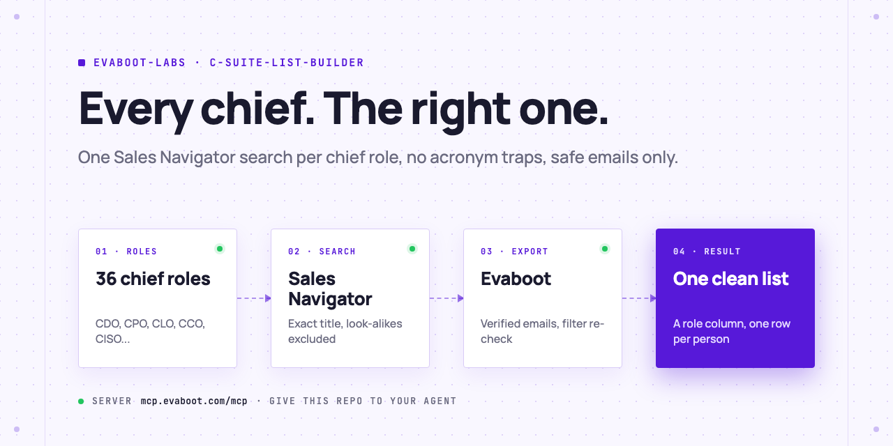
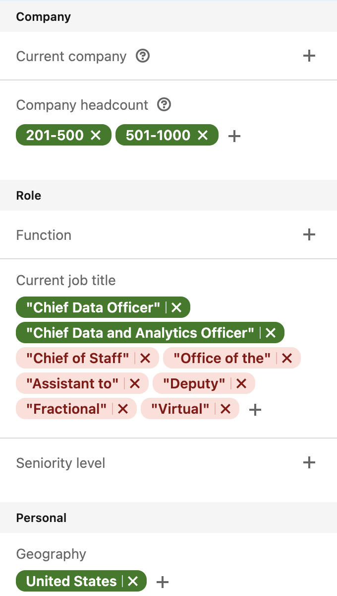
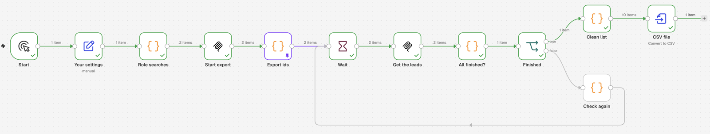
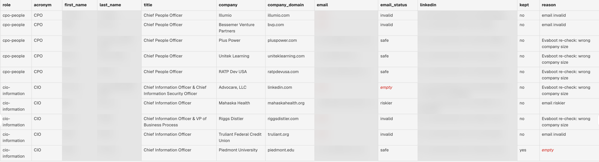

<picture>
  <source media="(prefers-color-scheme: dark)" srcset=".github/assets/banner-dark.png">
  
</picture>

# C-suite list builder

A clean C-level email list for the chief roles you choose: CDO, CPO, CLO, CCO, CISO and 31 more. One Sales Navigator search per role with the exact title, one small Evaboot export each, then a cleaning pass that drops the wrong meaning of each acronym, the side jobs and the unsafe emails.

[](AGENTS.md)
[](https://evaboot.com/mcp)
[](LICENSE)

## Set it up in one prompt

Paste this into Claude Code, Codex or Cursor:

```text
Clone https://github.com/evaboot-labs/c-suite-list-builder, read AGENTS.md and follow the skill. Build me a list of Chief Data Officers and Chief Legal Officers at US companies with 201 to 1,000 employees.
```

<details>
<summary>Or install the skill</summary>

Claude Code:

```text
/plugin marketplace add evaboot-labs/c-suite-list-builder
/plugin install c-suite-list-builder@evaboot-labs-c-suite-list-builder
```

Codex, Cursor and other agents:

```bash
npx skills add evaboot-labs/c-suite-list-builder
```

</details>

## How it works

**1. One exact title per role.** "CPO" means Product, People, Procurement or Privacy. Each role gets its own Sales Navigator search with the full title in quotes and the look-alikes (Chief of Staff, Deputy, Fractional) excluded.



**2. One small export per role.** Evaboot exports each search with verified emails, capped at the number of leads you choose.



**3. Only the leads that hold the role.** The cleaning pass keeps a lead when its current title is the role, it passes Evaboot's filter re-check and its email is safe. The rest go to a review file with the reason.



## What you need

- An [Evaboot account](https://dash.evaboot.com/accounts/signup/?last_click_origin=c-suite-list-builder-repo) and a Sales Navigator seat.
- Python 3 (standard library only), or n8n.
- Cost: 1 Evaboot credit per exported lead, email included. Start with 10 per role.

## Go further

| Page | For |
|---|---|
| [docs/roles.md](docs/roles.md) | The 36 roles, their title rules and the acronyms that mislead |
| [docs/connect-your-agent.md](docs/connect-your-agent.md) | The Evaboot connector or key, by hand, for each agent |
| [docs/n8n.md](docs/n8n.md) | The same list builder in n8n |

---

Agents: start at [AGENTS.md](AGENTS.md) · Built by [Evaboot](https://evaboot.com) · More workflows at [github.com/evaboot-labs](https://github.com/evaboot-labs) · [MIT license](LICENSE)
